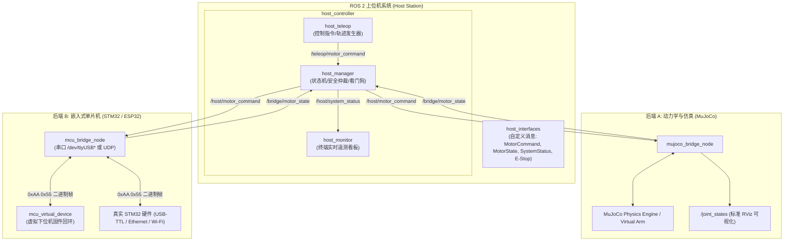

# ROS 2 上位机与多后端通信工作空间 (Host Supervisory Station)

本工作空间基于 **ROS 2 Jazzy**（Ubuntu 24.04 WSL2）搭建，为机器人/多轴机构提供标准的**上位机主控架构**，原生支持向 **MuJoCo 物理仿真** 与 **单片机下位机（STM32 / ESP32）** 进行闭环通信与状态监控。

---

## 1. 系统架构全景



---

## 2. 目录结构

```text
/home/bridge/projects/ros2/
├── env.sh                     # 快捷环境变量与别名脚本 (source env.sh)
├── manage.sh                  # 上位机一键管理 CLI (build, test, monitor, clean)
├── README.md                  # 本说明文档
├── scripts/
│   └── run_tests.sh           # 自动化回归与通信验证套件
└── src/
    ├── host_interfaces/       # 上位机自定义消息与服务包
    │   ├── msg/
    │   │   ├── MotorCommand.msg     # 目标位置/速度/力矩指令
    │   │   ├── MotorState.msg       # 下位机/仿真器反馈状态
    │   │   └── SystemStatus.msg     # 系统状态、频率、包计数、故障
    │   └── srv/
    │       ├── EmergencyStop.srv    # 软急停与安全恢复服务
    │       └── SetControlMode.srv   # 位置/速度/力矩模式切换
    ├── host_controller/       # 上位机主控核心包
    │   ├── host_manager.py          # 系统状态机、看门狗、安全仲裁
    │   ├── host_monitor.py          # 终端实时遥测 ANSI 看板
    │   ├── host_teleop.py           # 正弦激励/步进测试轨迹发生器
    │   └── launch/
    │       ├── host_system.launch.py   # 单独启动上位机
    │       └── full_station.launch.py  # 综合启动入口 (可切换 backend)
    ├── mujoco_bridge/         # MuJoCo 仿真桥接包
    │   ├── mujoco_node.py           # 仿真物理步进与反馈同步
    │   └── launch/test_bridge.launch.py # 仿真闭环测试启动
    └── mcu_bridge/            # 单片机与嵌入式通信桥接包
        ├── protocol.py              # 二进制数据帧封包/解包/CRC16
        ├── mcu_serial_node.py       # 串口/UDP 双模上位机通信节点
        ├── mcu_virtual_device.py    # 虚拟 STM32 固件模拟器 (无硬件时调试)
        └── launch/
            ├── test_loopback.launch.py    # 虚拟下位机回环测试
            └── mcu_real_hardware.launch.py# 真实硬件串口启动
```

---

## 3. 便捷日常管理与命令

打开任意 WSL 终端后，已配置好全局别名：
```bash
ros_ws         # 一键切换到工作空间目录并激活环境
```

工作空间根目录下提供了 `./manage.sh` 脚本：
```bash
./manage.sh build                 # 编译整个工作空间 (colcon build --symlink-install)
./manage.sh clean                 # 清除 build/install/log 缓存
./manage.sh rebuild               # 干净重新编译
./manage.sh test-mujoco           # 运行 MuJoCo 仿真桥接与上位机闭环测试
./manage.sh test-mcu-loopback     # 运行 MCU 虚拟回环与单片机通信测试
./manage.sh monitor               # 打开上位机实时遥测监控看板
./manage.sh teleop                # 打开轨迹/指令控制台
./manage.sh nodes                 # 列出当前活跃节点
./manage.sh topics                # 列出当前活跃话题
```

---

## 4. 通信测试与联调指南

### A. 与 MuJoCo 仿真测试
启动 MuJoCo 仿真闭环：
```bash
ros2 launch mujoco_bridge test_bridge.launch.py
```
在另一个终端启动上位机看板观察数据：
```bash
ros2 run host_controller host_monitor
```
> 说明：`mujoco_node` 会自动发布 `/joint_states` 话题，可直接配合 RViz2 或外部 MuJoCo 查看器进行 3D 机械臂姿态同步。

### B. 与单片机（MCU）测试
#### 1) 无硬件时的虚拟回环测试（已验证通过）
```bash
ros2 launch mcu_bridge test_loopback.launch.py
```
此时 `mcu_virtual_device` 扮演单片机固件，与 `mcu_bridge_node` 通过本地高速 UDP 进行帧通信，完全模拟真实单片机电机闭环、编码器上传与急停响应。

#### 2) 连接真实 STM32 / ESP32 硬件
单片机通过 USB 转串口线连接电脑，并在 WSL 中识别到 `/dev/ttyUSB0`（或 `/dev/ttyACM0`）后运行：
```bash
ros2 launch mcu_bridge mcu_real_hardware.launch.py serial_port:=/dev/ttyUSB0 baudrate:=115200
```

### C. 嵌入式二进制协议格式说明
`mcu_bridge/protocol.py` 采用了标准工业鲁棒二进制协议帧：
```text
[帧头 2B: 0xAA 0x55] [指令类型 1B] [数据长度 1B] [有效载荷 NB] [CRC16 校验 2B] [帧尾 2B: 0x0D 0x0A]
```
- **0x01 (CMD_MOTOR_SET)**: 下发模式 (uint8) + 6关节浮点目标值 (float32 * 6)
- **0x02 (STATE_FEEDBACK)**: 上报 6关节角度 (float32 * 6) + 6速度 (int16 * 6) + 6温度 (uint8 * 6) + 故障码 (uint16)
- **0x03 (CMD_ESTOP)**: 软急停触发 (1: 停机断电, 0: 解除)
- **0x04 (HEARTBEAT)**: 心跳与序列号防掉线
单片机端固件只需按此格式组包即可与上位机无缝对话。

### D. 一键全套回归验证脚本
验证所有节点与通信服务是否正常：
```bash
./scripts/run_tests.sh
```
